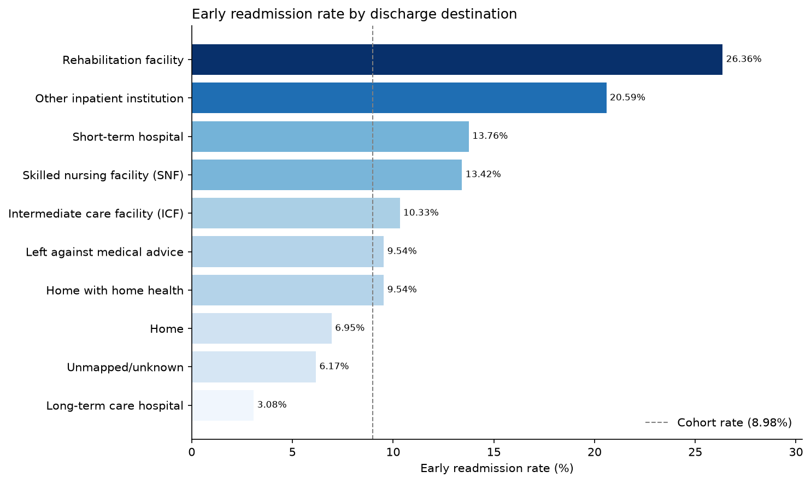
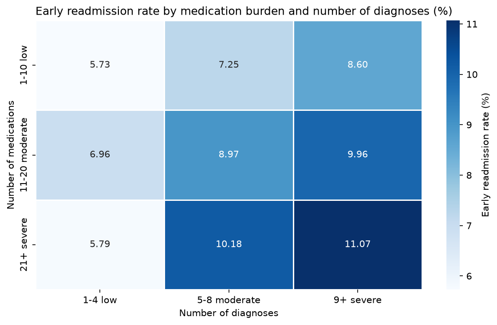

# Early Hospital Readmission in Patients with Diabetes: SQL, Python and Tableau Analysis

## Overview

This project conducts a descriptive analysis of early hospital readmission among patients with diabetes mellitus, using the Diabetes 130-US Hospitals for Years 1999–2008 dataset from the UCI Machine Learning Repository.

The analysis focuses on patient demographics, length of hospital stay, treatment patterns, clinical complexity, admission and discharge pathways, and other hospital-related characteristics.

The same analysis is carried out with three tools, and their results are cross-validated:

- **SQL (DuckDB):** data preparation, cohort construction and the main descriptive analysis.
- **Python (pandas):** an independent reproduction of the full SQL workflow in a Jupyter notebook, with charts.
- **Tableau Public:** an interactive dashboard of the key findings.

## Table of Contents

- [Objectives](#objectives)
- [Dataset](#dataset)
- [Data Preparation](#data-preparation)
- [Tools](#tools)
- [Methodology](#methodology)
  - [Cohort Construction](#cohort-construction)
  - [Minimum Group-Size Thresholds](#minimum-group-size-thresholds)
  - [Analytical Approach](#analytical-approach)
- [Key Findings](#key-findings)
- [Interactive Dashboard](#interactive-dashboard)
- [Python (pandas) Reproduction](#python-pandas-reproduction)
- [Repository Structure](#repository-structure)
- [Reproducibility](#reproducibility)
  - [SQL](#sql)
  - [Python](#python)
  - [Expected Validation](#expected-validation)
- [Project Report](#project-report)
- [Limitations](#limitations)
- [License](#license)
- [Acknowledgments](#acknowledgments)

## Objectives

- Build a reproducible analytical cohort from the original hospital encounter records.
- Quantify early readmission within 30 days of discharge.
- Describe readmission patterns across demographic, clinical, treatment, and hospital-related groups.
- Reproduce the analysis in a second tool to validate the results.
- Document methodological decisions, data limitations, and reproducibility checks.

## Dataset

Source: [UCI Machine Learning Repository — Diabetes 130-US Hospitals for Years 1999–2008](https://archive.ics.uci.edu/dataset/296/diabetes+130-us+hospitals+for+years+1999-2008)

The dataset contains hospital encounter records for patients with diabetes across multiple US hospitals between 1999 and 2008.

The principal outcome is early readmission, defined as a readmission recorded as `<30` in the original `readmitted` variable.

## Data preparation

The original dataset includes `diabetic_data.csv` and `IDS_mapping.csv`. The latter contains mapping information for admission type, admission source, and discharge disposition.

For this project, the mapping information is provided as three separate lookup files in `data/reference/`:

- `admission_type.csv`
- `admission_source.csv`
- `discharge_disposition.csv`

The original encounter dataset must be downloaded separately and placed in `data/raw/`.

## Tools

- **SQL:** data cleaning, cohort construction, table joins, Common Table Expressions (CTEs), window functions (ROW_NUMBER, RANK), conditional logic (CASE WHEN), filtering (WHERE), grouping (GROUP BY), sorting (ORDER BY), aggregations, and descriptive analysis.
- **DuckDB:** SQL execution engine.
- **DBeaver:** database client and query development environment.
- **Python:** pandas and NumPy for data preparation and analysis; matplotlib and seaborn for charts.
- **Jupyter:** notebook environment for the Python reproduction.
- **Tableau Public:** interactive dashboard.

## Methodology

### Cohort construction

The original dataset contains 101,766 hospital encounters involving 71,518 unique patients.

The analytical cohort was constructed by:

- Excluding encounters with discharge dispositions associated with death or hospice care.
- Selecting one eligible encounter per patient using the minimum `encounter_id`.
- Creating a binary indicator for early readmission within 30 days.
- Validating record counts and preparing the resulting cohort for descriptive analysis.

The final analytical cohort contains 69,990 patients.

Because exact admission and discharge dates are unavailable, the minimum `encounter_id` is used as a selection proxy. It cannot guarantee that the selected encounter is chronologically the patient's first hospitalization.

### Minimum group-size thresholds

To limit the interpretation of estimates based on small groups, the following minimum sample sizes were established:

- Sex and race, discharge destination, and treatment: at least 100 records per group.
- Hospital care pathways: at least 500 records per group, defined by the combination of admission type, admission source, and discharge destination.
- Medical specialties: at least 200 records per group.
- Other comparisons: all groups were displayed, but groups with fewer than 100 patients were not interpreted.

### Analytical approach

The analysis is descriptive. No hypothesis tests or multivariable models were performed. Therefore, the results describe observed patterns and do not establish causal relationships or identify factors independently associated with readmission.

## Key Findings

- **Overall early readmission:** 6,285 patients were readmitted within 30 days, representing 8.98% of the final cohort (n = 69,990).
- **Length of stay:** early readmission rates rose from 7.5% (1–3 days) to 11.8% (8–14 days).
- **Discharge destination:** the early readmission rate was 26.4% among patients discharged to rehabilitation (n = 1,411), compared with 6.95% among those discharged home (n = 44,322).
- **Clinical complexity:** rates rose from 5.7% (1–10 medications and 1–4 diagnoses) to 11.1% (21+ medications and 9+ diagnoses).
- **HbA1c measurement:** HbA1c was measured in 18.35% of the cohort (n = 12,846). Early readmission was 8.40% among patients with a recorded measurement and 9.11% among those without one.

These findings are descriptive and should be interpreted in the context of the study's cohort definitions, group sizes, and methodological limitations.

<p align="center">
  
  
</p>

## Interactive Dashboard

### Executive Summary

- **Dashboard overview:** Developed an interactive Tableau dashboard using the UCI Diabetes 130-US Hospitals for Years 1999–2008 dataset. The final cohort includes 69,990 patients, and the overall early readmission rate (readmission within 30 days of discharge) was 8.98%.
- **Key findings:** Early readmission rates varied across hospital and clinical characteristics. Patients discharged to rehabilitation facilities had a rate of 26.36% (n = 1,411), compared with 6.95% among those discharged home (n = 44,322). Rates were also higher with longer stays, from 7.53% for stays of 1–3 days to 11.79% for stays of 8–14 days.
- **Interpretation and limitations:** The dashboard presents descriptive, unadjusted comparisons across discharge destination, length of stay, clinical complexity, HbA1c measurement status, and age groups. Patients with no recorded discharge destination (n = 2,474) are not shown in the discharge destination chart. Results should be interpreted cautiously, particularly for small groups, and do not establish causal relationships.

[View the dashboard on Tableau Public](https://public.tableau.com/app/profile/mane.mtz/viz/EarlyReadmissioninDiabetes/HospitalReadmissionAnalysis)


## Python (pandas) Reproduction

The notebook [`notebooks/diabetes_early_readmission_pandas.ipynb`](notebooks/diabetes_early_readmission_pandas.ipynb) reproduces the complete SQL workflow in Python, from data loading to the ten analytical questions:

- **Data preparation:** loading, data-quality checks, the binary readmission variable, and lookup tables.
- **Cohort construction:** the same exclusion and one-encounter-per-patient criteria as the SQL scripts, with the SQL equivalent noted in the code (for example, `ROW_NUMBER()` and `TRY_CAST`).
- **Analysis:** questions Q1–Q10, each followed by its finding.
- **Charts:** five figures created with matplotlib and seaborn and saved to `plots/`.

**Cross-validation:** the notebook reproduces the SQL results exactly, including the cohort size (69,990 patients) and the overall early readmission rate (8.98%).

## Repository Structure

```text
diabetes-readmission-analysis/
├── README.md
├── LICENSE
├── requirements.txt
├── sql/
│   ├── 01_load_and_clean.sql
│   └── 02_analysis.sql
├── notebooks/
│   └── diabetes_early_readmission_pandas.ipynb
├── plots/
│   ├── 01_readmission_outcomes.png
│   ├── 02_readmission_by_length_of_stay.png
│   ├── 03_readmission_by_hba1c.png
│   ├── 04_readmission_by_discharge_destination.png
│   └── 05_clinical_complexity_heatmap.png
├── dashboard/
│   └── dashboard_preview.png
├── data/
│   ├── README.md
│   ├── raw/
│   └── reference/
│       ├── admission_type.csv
│       ├── admission_source.csv
│       └── discharge_disposition.csv
└── docs/
    └── early_hospital_readmission_analysis.pdf
```

The original `diabetic_data.csv` file is not included in the repository. It must be downloaded from the original source and placed in `data/raw/` before running the scripts or the notebook.

## Reproducibility

1. Clone or download this repository.
2. Download `diabetic_data.csv` from the UCI Machine Learning Repository and place it in `data/raw/`.

### SQL

3. Open the project in DuckDB through a compatible SQL client, such as DBeaver.
4. Execute `sql/01_load_and_clean.sql` first, then `sql/02_analysis.sql`.

The scripts use relative paths beginning with `data/`. If your SQL client runs from a different working directory (for example, DBeaver), set the working directory to the repository root or adjust the paths in the `read_csv_auto` calls.

### Python

3. Create a virtual environment and install the dependencies:

   ```bash
   pip install -r requirements.txt
   ```

4. Open `notebooks/diabetes_early_readmission_pandas.ipynb` and run all cells (**Kernel → Restart & Run All**). The charts are saved to `plots/`.

### Expected validation

Both workflows should reproduce the following record counts:

101,766 original encounters → 69,990 patients in the final analytical cohort (early readmission rate: 8.98%)

Differences may indicate issues with file preparation, paths, lookup data, or the execution of the cohort selection criteria.

## Project Report

The accompanying report, *Early Hospital Readmission in Patients with Diabetes: A Descriptive SQL Analysis*, provides additional methodological details, descriptive results, and interpretation.

See [docs/early_hospital_readmission_analysis.pdf](docs/early_hospital_readmission_analysis.pdf).

## Limitations

- The dataset covers hospital encounters from 1999 to 2008; the findings may not reflect current clinical practice.
- The available data do not provide exact admission and discharge dates for establishing encounter chronology.
- Selecting the minimum `encounter_id` does not guarantee selection of the chronologically first encounter.
- Some demographic and clinical categories contain relatively few observations.
- The analysis is descriptive and does not establish causality or independent associations.
- Recorded HbA1c measurements and medication changes may reflect clinical decisions or patient characteristics that cannot be fully evaluated using this analysis alone.

## License

The code in this repository is released under the MIT License. The dataset remains subject to the terms and conditions specified by the original data provider.

## Acknowledgments

The dataset was provided by the UCI Machine Learning Repository.

Dataset citation:

Clore, J., Cios, K., DeShazo, J., & Strack, B. (2014). *Diabetes 130-US Hospitals for Years 1999–2008* [Dataset]. UCI Machine Learning Repository. [https://doi.org/10.24432/C5230J](https://doi.org/10.24432/C5230J)
